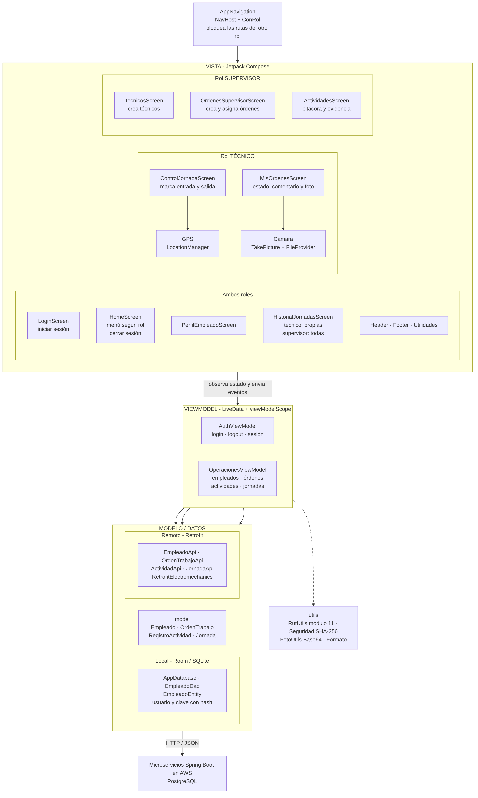
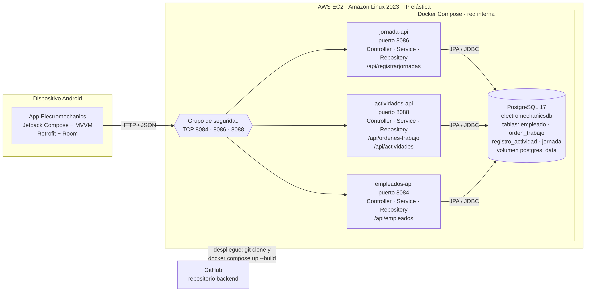

# Electromechanics App

Aplicación móvil Android para el registro de jornada con GPS y el seguimiento de tareas de mantención de **Electromechanics Ingeniería SpA**. Está desarrollada con Kotlin y Jetpack Compose bajo el patrón MVVM, y se conecta por Retrofit a tres microservicios Spring Boot desplegados en AWS.

Proyecto de la asignatura DSY1105 Desarrollo de Aplicaciones Móviles, Sección 011D, Duoc UC.

## Roles

La aplicación muestra opciones distintas según el rol del usuario. Cada pantalla está protegida en la navegación: si un usuario intenta abrir una ruta del otro rol, vuelve al panel principal.

| Función | Técnico | Supervisor |
|---|---|---|
| Iniciar y cerrar sesión | Sí | Sí |
| Ver perfil | Sí | Sí |
| Marcar entrada y salida con GPS | Sí | No |
| Ver sus órdenes, cambiar el estado y registrar actividades con foto | Sí | No |
| Historial de jornadas | Solo las propias | De todos los técnicos |
| Crear técnicos | No | Sí |
| Crear y asignar órdenes de trabajo | No | Sí |
| Revisar la bitácora de actividades y su evidencia | No | Sí |

Solo el supervisor puede crear usuarios, y siempre con el rol Técnico.

## Arquitectura

### Proyecto Android (MVVM)



### Microservicios



La explicación detallada de cada capa está en [docs/README.md](docs/README.md). Los diagramas están en la rama `documents`.

## Tecnologías

| Área | Tecnología |
|---|---|
| Lenguaje | Kotlin 2.0.21 |
| Interfaz | Jetpack Compose, Material 3 |
| Arquitectura | MVVM con `ViewModel` y `LiveData` |
| Navegación | Navigation Compose |
| Almacenamiento local | Room sobre SQLite |
| Red | Retrofit, Gson y OkHttp |
| Recursos nativos | GPS (`LocationManager`) y cámara (`TakePicture` y `FileProvider`) |
| Build | Gradle, Android Gradle Plugin 8.7.0, KSP |
| SDK | `minSdk` 26, `compileSdk` y `targetSdk` 35 |

## Estructura del proyecto

```
app/src/main/java/com/example/electromechanics/app/
├── MainActivity.kt
├── model/                 Empleado, OrdenTrabajo, RegistroActividad, Jornada
├── data/
│   ├── api/               interfaces Retrofit y RetrofitElectromechanics
│   ├── database/          AppDatabase (Room)
│   └── local/
│       ├── dao/           EmpleadoDao
│       └── entity/        EmpleadoEntity
├── ui/
│   ├── components/        Header, Footer, Utilidades
│   ├── navigation/        AppNavigation y control de acceso por rol
│   ├── screen/            pantallas Compose
│   ├── theme/             colores, tipografía y tema
│   └── viewmodel/         AuthViewModel y OperacionesViewModel
└── utils/                 RutUtils, Seguridad, FotoUtils, Formato
```

## Requisitos

- Android Studio con JDK 11 o superior y el SDK de Android 35.
- Un emulador o un teléfono con Android 8.0 (API 26) o superior.
- El backend en ejecución, local o en la nube. Está en el repositorio [electromechanics-backend](https://github.com/damerinop/microservicios-electromechanicsapp).

## Configuración

La dirección del backend se define en `data/api/RetrofitElectromechanics.kt`, dentro de `ApiConfig`:

```kotlin
const val HOST = "10.0.2.2"
const val PUERTO_EMPLEADOS = 8084
const val PUERTO_ACTIVIDADES = 8088
const val PUERTO_JORNADA = 8086
```

| Dónde corre la app | Valor de `HOST` |
|---|---|
| Emulador con el backend en tu PC | `10.0.2.2` |
| Teléfono físico con el backend en tu PC | IPv4 de tu PC en la red WiFi |
| Backend en AWS | IP elástica de la instancia EC2 |

El manifiesto habilita `usesCleartextTraffic` porque el backend responde por HTTP. En producción debe usarse HTTPS.

## Ejecución

1. Clona el repositorio y ábrelo con Android Studio.
2. Espera a que Gradle sincronice. Android Studio genera `local.properties` con la ruta de tu SDK.
3. Ajusta `HOST` según la tabla anterior.
4. Verifica que el backend responda en `http://HOST:8084/api/empleados`.
5. Ejecuta la app con **Run**.

### Primer uso

La base de datos del backend parte vacía y la app solo crea técnicos, por lo que el primer supervisor se crea desde Postman:

```
POST http://HOST:8084/api/empleados
```

```json
{
  "rutTrabajador": "11111111-1",
  "nombreCompleto": "Supervisor Demo",
  "rol": "SUPERVISOR",
  "correoCorporativo": "sup@demo.cl",
  "contrasena": "supervisor1234"
}
```

Luego se inicia sesión en la app con ese RUT y esa contraseña, y el supervisor crea los técnicos desde **Gestión de Técnicos**.

## Funcionamiento destacado

- **Autenticación y sesión:** el login valida las credenciales contra el microservicio de empleados y guarda el usuario en Room con la contraseña como hash SHA-256. La sesión persiste al cerrar la app, y las credenciales guardadas permiten volver a entrar sin conexión.
- **Validaciones:** el RUT se valida con el algoritmo módulo 11, y los técnicos nuevos exigen una contraseña de al menos 10 caracteres.
- **Jornada con GPS:** las marcaciones de entrada y salida requieren una posición GPS. El estado de la jornada se calcula con la última marcación guardada en el servidor.
- **Evidencia fotográfica:** la foto se captura con la cámara, se reduce a 800 px, se comprime a JPEG y se envía en Base64. El supervisor la visualiza en la bitácora.

## Permisos

| Permiso | Uso |
|---|---|
| `INTERNET` | Consumir los microservicios |
| `ACCESS_FINE_LOCATION`, `ACCESS_COARSE_LOCATION` | Geolocalización de las marcaciones |
| `CAMERA` | Evidencia fotográfica |

Los permisos de ubicación y cámara se solicitan en tiempo de ejecución, al abrir la pantalla que los necesita.

## Limitaciones

Este es un MVP académico. El backend no tiene autenticación en sus endpoints ni cifrado de transporte, y la restricción por rol se aplica en la app. Los detalles están en el README del repositorio del backend.
