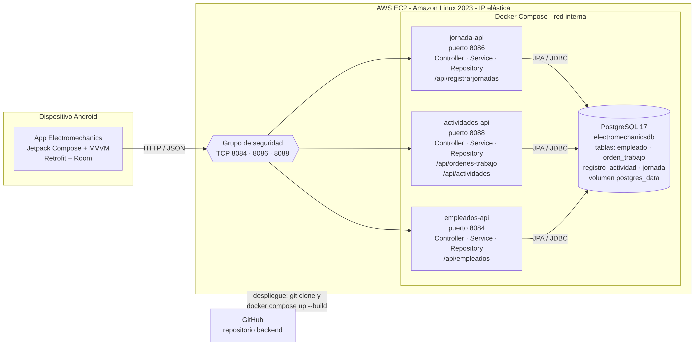
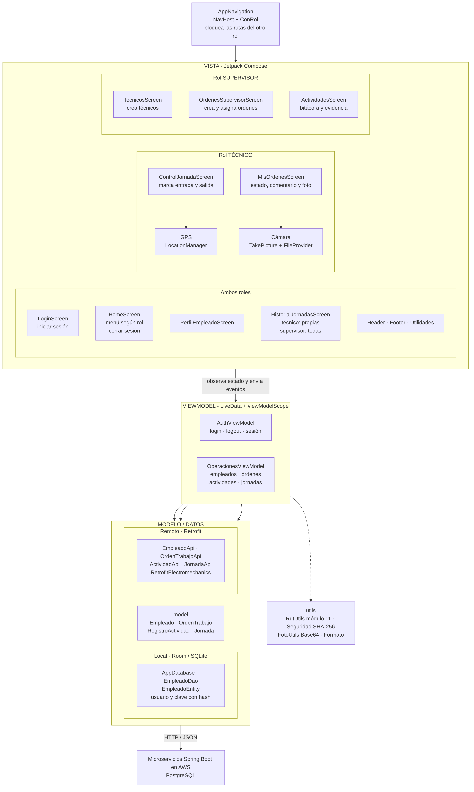

# Documentación de arquitectura

Sistema Móvil de Registro de Jornada y Seguimiento de Tareas de Mantención, Electromechanics Ingeniería SpA. Esta rama reúne los diagramas de arquitectura de la Experiencia 3.

Contenido:

1. [Arquitectura de microservicios](#1-arquitectura-de-microservicios)
2. [Arquitectura del proyecto Android](#2-arquitectura-del-proyecto-android)

## 1. Arquitectura de microservicios

Código fuente del diagrama: [arquitectura-microservicios.mmd](diagramas/arquitectura-microservicios.mmd)

El backend está formado por tres microservicios Spring Boot independientes que comparten una base PostgreSQL. Se ejecutan como contenedores Docker orquestados con Docker Compose en una instancia AWS EC2 con IP elástica. La app Android los consume por HTTP con Retrofit.

| Microservicio | Puerto | Endpoints | Tabla |
|---|---|---|---|
| empleados-api | 8084 | `/api/empleados` | `empleado` |
| actividades-api | 8088 | `/api/ordenes-trabajo`, `/api/actividades` | `orden_trabajo`, `registro_actividad` |
| jornada-api | 8086 | `/api/registrarjornadas` | `jornada` |

Cada microservicio sigue la misma estructura en capas: `Controller` (recibe la petición REST), `Service` (reglas de negocio), `Repository` (Spring Data JPA) y `Entity` (tabla). Las reglas de los services y los controllers están cubiertas con pruebas unitarias JUnit 5 y Mockito.

Despliegue: el código se sube a GitHub, se clona en la EC2 y se levanta con `docker compose up -d --build`. El grupo de seguridad solo abre los puertos 8084, 8086 y 8088; PostgreSQL permanece en la red interna de Docker.

## 2. Arquitectura del proyecto Android

Código fuente del diagrama: [arquitectura-proyecto-android.mmd](diagramas/arquitectura-proyecto-android.mmd)

La aplicación sigue el patrón MVVM con Jetpack Compose y está delimitada a dos roles: Técnico y Supervisor.

### Capas

| Capa | Paquete | Contenido |
|---|---|---|
| Vista | `ui/screen`, `ui/components` | Pantallas Compose, `Header`, `Footer` y utilidades de interfaz |
| Navegación | `ui/navigation` | `AppNavigation`: `NavHost` y control de acceso por rol |
| ViewModel | `ui/viewmodel` | `AuthViewModel` y `OperacionesViewModel`, con `LiveData` y `viewModelScope` |
| Datos remotos | `data/api` | Interfaces Retrofit y `RetrofitElectromechanics` |
| Datos locales | `data/database`, `data/local` | Room sobre SQLite: `AppDatabase`, `EmpleadoDao`, `EmpleadoEntity` |
| Modelo | `model` | `Empleado`, `OrdenTrabajo`, `RegistroActividad`, `Jornada` |
| Utilidades | `utils` | `RutUtils` (módulo 11), `Seguridad` (SHA-256), `FotoUtils` (Base64), `Formato` |

### Funcionalidad por rol

| Función | Técnico | Supervisor |
|---|---|---|
| Iniciar y cerrar sesión | Sí | Sí |
| Perfil | Sí | Sí |
| Control de jornada con GPS | Sí | No |
| Mis órdenes, cambio de estado y evidencia con cámara | Sí | No |
| Historial de jornadas | Solo las propias | De todos los técnicos |
| Crear técnicos | No | Sí |
| Crear y asignar órdenes de trabajo | No | Sí |
| Bitácora de actividades con evidencia | No | Sí |

### Recursos nativos

- GPS (`LocationManager`) en el control de jornada del técnico.
- Cámara (`TakePicture` y `FileProvider`) en la gestión de órdenes del técnico. La foto se reduce, se comprime a JPEG y se envía en Base64.

### Autenticación y almacenamiento local

El inicio de sesión consulta el microservicio de empleados y guarda el usuario en Room con la contraseña como hash SHA-256. La sesión persiste al cerrar la app, y las credenciales guardadas permiten volver a entrar sin conexión. Cerrar sesión desactiva la sesión activa.

### Control de acceso por rol

`HomeScreen` muestra un menú distinto según el rol. Además, `AppNavigation` envuelve cada ruta con `ConRol`: si un técnico intenta abrir una pantalla de supervisor, o al revés, vuelve al panel principal.

Nota: `RegistroJornadaEntity` y su DAO existen en `data/local`, pero las jornadas se guardan en el microservicio y no se usan en las pantallas.
